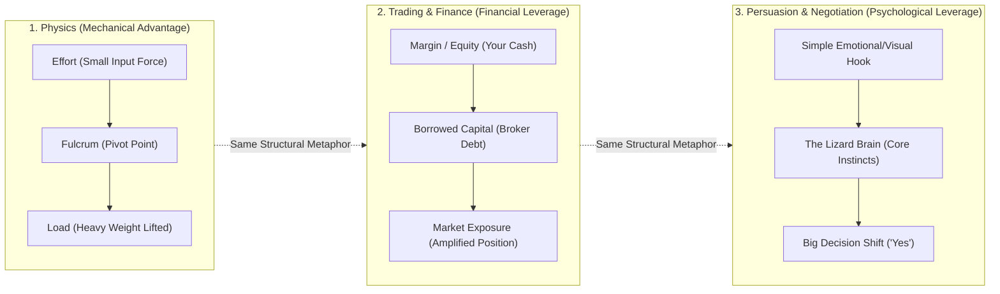

# Preply Trial Lesson Notes: The Lizard Brain, Persuasion & Leverage

Notes from our 25-minute Preply trial lesson covering **The Lizard Brain**, **how to persuade effectively**, and the vocabulary of **"Leverage"** across **Physics**, **Business/Trading**, and **Psychology**.

---

## 1. The "Lizard Brain" & How to Persuade

In psychology and communication, human decision-making is often divided into two systems:

| Feature | The "Lizard Brain" (Primitive / Limbic / Amygdala) | The Logical Brain (Neocortex) |
| :--- | :--- | :--- |
| **Speed** | **Fast**, automatic, instinctive | **Slow**, deliberate, analytical |
| **Core Drive** | Survival, safety, status, avoiding pain, seeking reward | Facts, abstract data, spreadsheets, long-term planning |
| **Role in Persuasion** | **The Gatekeeper & Decision Maker** (feels first) | **The Justifier** (rationalizes what the Lizard Brain already decided) |

### Key Persuasion Principles (Appealing to the Lizard Brain)
1. **Lower Perceived Threat (Safety First):** If the Lizard Brain senses pressure, complexity, or danger, it triggers *fight, flight, or freeze*. Keep proposals low-friction and safe.
2. **Concrete & Visual > Abstract:** The Lizard Brain doesn't process abstract percentages well; it responds to vivid stories, physical metaphors (like a lever!), and clear *before vs. after* contrasts.
3. **Loss Aversion (Avoiding Pain):** People are roughly twice as motivated to **avoid a loss** as they are to achieve an equal gain.
4. **Scarcity & Urgency:** Limited availability triggers the primitive instinct not to miss out (*FOMO*).
5. **What's In It For Me? (Self-Interest):** Frame ideas around immediate survival, relief, or status benefits for the listener.

---

## 2. The Concept of "Leverage": Physics → Trading → Persuasion

The English word **leverage** comes from **lever** (French *levier*, from Latin *levare* = "to make light / to lift"). In every field, **leverage** means **using a strategic pivot point (fulcrum) so that a small input produces a multiplied output**.

---

## 3. Side-by-Side Vocabulary Breakdown

### A. Physics Leverage (The Physical Metaphor)
> *"Give me a lever long enough and a fulcrum on which to place it, and I shall move the world."* — Archimedes

* **Lever:** A rigid beam or bar used to move a heavy object.
* **Fulcrum (Pivot):** The fixed support point on which the lever rests and turns.
* **Effort (Input Force):** The small force you apply to the long end of the lever.
* **Load (Output Force / Resistance):** The heavy object being lifted on the short end.
* **Mechanical Advantage ($\text{MA} = \frac{d_{\text{effort}}}{d_{\text{load}}}$):** The multiplication factor. If the effort arm is $10\times$ longer than the load arm, your force is multiplied by $10\times$ (at the cost of pushing over a $10\times$ longer distance).

---

### B. Business & Trading Leverage (Financial Amplification)
In business and financial trading, **leverage** works just like a physical lever: instead of lifting a heavy rock with a long bar, you control a **large market position** using a **small amount of your own cash** plus **borrowed funds**.

| Physics Term | Trading / Business Term | Definition & Example |
| :--- | :--- | :--- |
| **Effort (Input Force)** | **Margin / Equity (Collateral)** | Your own money put down to open the trade (e.g., `\$1,000`). |
| **Fulcrum (Pivot)** | **Borrowed Capital / Debt** | Money loaned by the broker or bank (`\$9,000`) that acts as the force multiplier. |
| **Lever Length Ratio** | **Leverage Ratio (e.g., `10x` or `10:1`)** | The ratio of total position size to your actual cash equity. |
| **Load (Output Force)** | **Exposure / Buying Power (Position Size)** | The total value of assets you control in the market (`\$10,000`). |
| **Breaking the Lever** | **Margin Call / Liquidation** | In physics, if the load is too heavy or moves the wrong way, the lever snaps. In trading, leverage **amplifies both gains and losses**: with `10x` leverage, a `+10%` move doubles your money (`+100%`), but a `-10%` drop wipes out your entire `\$1,000` margin (**Liquidation**). |

#### Other Common Idioms & Collocations with "Leverage" in Business
* **Verb — *"To leverage"*:** To use something you already have to maximum advantage.
  * *Example:* *"We can **leverage** our existing customer base to launch the new product."*
* **Operational Leverage:** Using fixed costs (like software/code, automation, or media) so that revenue grows much faster than expenses.
* **Negotiation Leverage (Bargaining Power):** Holding an advantage that the other side needs (or having strong alternatives, known as **BATNA** — *Best Alternative to a Negotiated Agreement*).
  * *Example:* *"Because we have three other job offers, we have strong **leverage** in salary negotiations."*

---

### C. How Physics, Trading, and the Lizard Brain Connect
1. **Don't push the heavy load with bare hands (Neocortex):** Trying to persuade someone purely with dense facts and logic is like trying to deadlift a boulder without a lever—high effort, high resistance.
2. **Use the Lizard Brain as your Fulcrum:** By placing your "fulcrum" on what the Lizard Brain cares about (safety, status, urgency, loss aversion, visual simplicity), a **small, well-placed input** shifts a **massive decision**.
3. **Respect the Risk of High Leverage:** Just as `10x` leverage in trading can cause a *margin call* if the market moves against you, overly aggressive psychological leverage (like fake urgency or manipulation) can backfire and break trust if the other person feels threatened.
