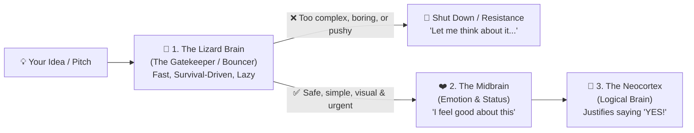
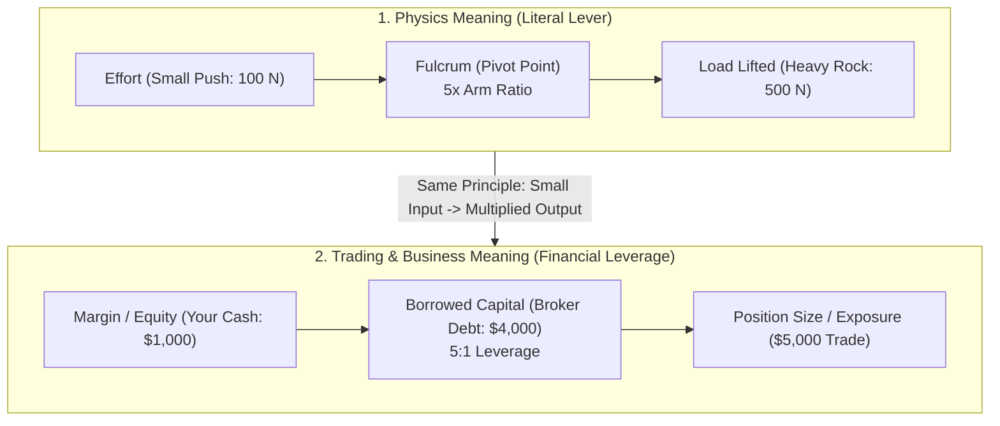

# Preply Trial Lesson Notes: Selling an Idea to the "Lizard Brain" + Vocabulary ("Leverage")

Notes from our 25-minute Preply trial lesson covering:
1. **Main Topic:** **The "Lizard Brain" & How to Persuade / Sell an Idea**
2. **Vocabulary Spotlight:** What **"Leverage"** means — from **Physics** to **Business & Trading**

---

## Part 1: The "Lizard Brain" & Selling an Idea

### 1. Why Most Good Ideas Get Rejected (The Pitching Trap)
When we have a great idea, we usually explain it using our **Logical Brain (Neocortex)** — facts, statistics, spreadsheets, and logical arguments — hoping to convince the other person's **Logical Brain**.

**The Problem:** Every message must first pass through the listener's **Lizard Brain** (the primitive, survival-focused part of the brain). Think of the Lizard Brain as the **bouncer at the door**:

---

### 2. How the "Lizard Brain" Thinks vs. The Logical Brain

| Feature | 🦎 The Lizard Brain (*Reptilian / Amygdala*) | 🧠 The Logical Brain (*Neocortex*) |
| :--- | :--- | :--- |
| **Main Job** | **Survival & Energy Saving:** Keep you safe without burning calories thinking too hard | **Deep Analysis:** Math, abstract logic, long-term planning, language |
| **Speed** | **Instant & Automatic** (reacts in milliseconds) | **Slow & Deliberate** (takes effort and focus) |
| **Reaction to Complexity** | **Hates it!** Complex data feels like hard work or a trap $\rightarrow$ tunes out | **Loves it**, *but only after* the Lizard Brain decides the idea matters |
| **Role When You Sell an Idea** | **Makes the real decision** based on instinct and safety | **Rationalizes** the decision the Lizard Brain already made |

#### The 3 Questions the Lizard Brain Instantly Asks About Your Idea:
1. **"Is this a threat?"** (If you sound pushy, aggressive, or risky, it triggers *fight, flight, or freeze* and creates instant **pushback**.)
2. **"Is this boring?"** (If it sounds like everything else, the Lizard Brain ignores it to save energy.)
3. **"Is this too complicated?"** (If it requires heavy mental effort to understand, the Lizard Brain blocks it.)

---

### 3. Six Rules for Selling an Idea to the Lizard Brain

1. **Answer *"What's In It For Me?"* Immediately (Self-Centered):**
   * The Lizard Brain only cares about its own survival, comfort, and status. Start your pitch with **their problem**, not your backstory.
2. **Use Sharp Contrast (*Before vs. After*):**
   * The Lizard Brain struggles with abstract percentages (e.g., *"a 14.2% efficiency gain"*), but it instantly understands **clear contrast**: *Pain Today* vs. *Relief Tomorrow* (or *With this idea* vs. *Without this idea*).
3. **Make It Concrete & Simple (Zero Jargon):**
   * Speak in simple, tangible terms a 10-year-old could picture. If the Lizard Brain has to burn calories decoding corporate buzzwords, you lose the room.
4. **Use Visuals & Short Stories:**
   * The visual nerve connects directly to the primitive brain and processes information **much faster** than spoken words or text slides. Paint a mental picture.
5. **Tap Into Loss Aversion (Avoiding Pain > Gaining Pleasure):**
   * Psychologically, people are roughly **twice as motivated to avoid a loss** as they are to achieve an equal gain. Show what they risk losing if they do nothing.
6. **Own the First 60 Seconds & the Final Takeaway:**
   * The Lizard Brain wakes up at the **beginning** and the **end** of a conversation, and goes on autopilot in the middle. Hook them early and finish with one unforgettable point.

---

### 4. Key Vocabulary & Idioms for Selling an Idea

* **To pitch an idea / An elevator pitch:** To present an idea quickly and persuasively (as if during a 30-second elevator ride).
* **To get buy-in:** To persuade people (bosses, clients, teammates) to support and agree with your idea.
  * *"We need to **get buy-in** from management before launching the project."*
* **Pushback / Resistance:** Negative reaction or objections when people feel threatened by a new idea.
* **Knee-jerk reaction:** An automatic, unthinking emotional response from the Lizard Brain.
* **Gut feeling / Instinct:** An immediate emotional intuition before logical analysis.
* **Information overload / Analysis paralysis:** Giving someone so many facts that their brain freezes and makes no decision at all.
* **To hook someone:** To capture someone's curiosity immediately at the start of a pitch.

---
---

## Part 2: Vocabulary Spotlight — What Does "Leverage" Mean?

*(Vocabulary note from our lesson: understanding the literal meaning of **leverage** in physics vs. how it is used in business and financial trading.)*

The word **leverage** comes from **lever** (from Latin *levare* = "to lift" or "to make light"). At its core, **leverage** means **using a multiplier so a small input produces a huge output**.

### Side-by-Side Vocabulary: Physics vs. Trading & Business

| Physics Vocabulary | Trading & Business Vocabulary | How They Relate |
| :--- | :--- | :--- |
| **Lever** *(Rigid bar)* | **Leverage** *(Financial multiplier)* | The tool used to multiply your power beyond your natural strength. |
| **Effort** *(Small Input Force)* | **Margin / Equity / Collateral** *(Your Own Cash)* | What you put in yourself (e.g., pushing with `100 N`, or putting down `\$1,000` of your own money). |
| **Fulcrum** *(Pivot Point)* | **Borrowed Capital / Debt** *(Broker or Bank Loan)* | The support point that multiplies your input. Moving the fulcrum closer to the load = borrowing more money (`5x`, `10x`, `20x`). |
| **Load** *(Heavy Resistance Lifted)* | **Market Exposure / Buying Power / Position Size** | The large result you control (lifting a `1,000 N` boulder, or controlling a `\$10,000` position in the market). |
| **Trade-off / Overload** | **Amplified Risk / Margin Call / Liquidation** | In physics, a longer lever requires moving a longer distance, and too much weight snaps the bar. In trading, leverage **multiplies both profits and losses** — if a `10x` leveraged trade drops by `10%`, you lose `100%` of your `\$1,000` margin (**Liquidation / Margin Call**). |

### Everyday Business Uses of "Leverage"
1. **In Trading & Finance (Noun):**
   * *"Trading with high **leverage** (like 20:1) lets you control a huge position with very little **margin**, but a small price drop will trigger a **margin call**."*
2. **In General Business (Verb — *"to leverage"* = to use something to maximum advantage):**
   * *"We can **leverage** our existing brand reputation to sell this new idea."*
3. **In Negotiation (Noun — *"bargaining power"*):**
   * *"If they know we have no other options, we lose all our **leverage** in the deal."*
