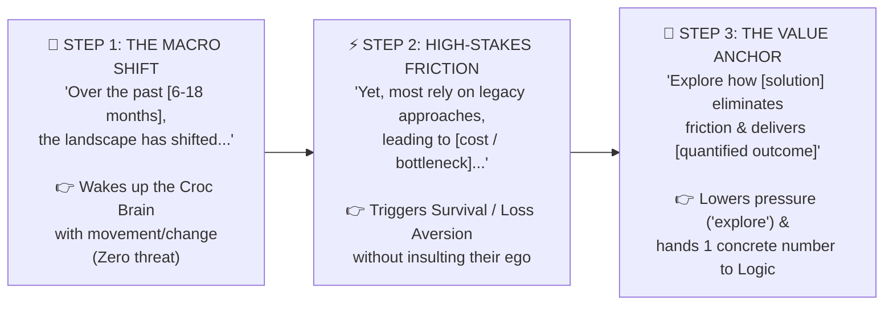
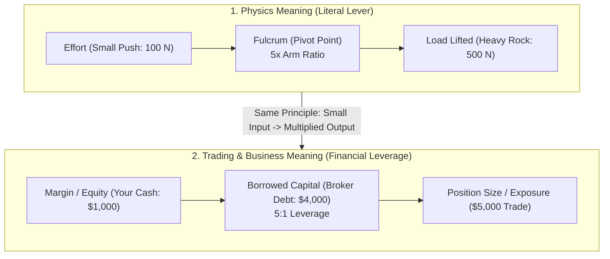

# Preply Trial Lesson Notes: The Crocodile / Lizard Brain Pitch Framework + "Leverage" Vocabulary

Notes from our 25-minute Preply trial lesson covering:
1. **Main Topic:** **The Crocodile / Lizard Brain in Selling an Idea** (and the exact **3-Step Pitch Opening Framework** we used to demonstrate it).
2. **Vocabulary Spotlight:** What **"Leverage"** means — from **Physics** to **Business & Trading**.

---

## Part 1: Selling an Idea to the "Crocodile / Lizard Brain"

### 1. Why the Crocodile Brain Controls the Pitch
When you pitch an idea, you think you are speaking to the listener's sophisticated **Logical Brain (Neocortex)**. In reality, every message enters through their primitive **Crocodile / Lizard Brain** first.

The Crocodile Brain acts like a ruthless survival filter (the "bouncer at the door"):
* It **ignores static/boring things** to conserve energy.
* It **blocks complex data or jargon** that requires burning too many mental calories.
* It gets **defensive (fight-or-flight)** if it feels attacked or pressured.
* It **wakes up immediately** when it senses **environmental movement (change)**, **danger/loss**, and a **simple, safe path to relief**.

---

### 2. The 3-Step "Crocodile Brain" Pitch Framework

Here is the exact 3-step opening script we used to demonstrate how to speak to the Crocodile Brain and seamlessly hand off to the Logical Brain:

```text
+---------------------------------------------------------------------------------------------------+
| STEP 1: THE MACRO SHIFT                                                                           |
| "Over the past [6-18 months], the market / operational landscape in [industry] has shifted..."    |
|                                                                                                   |
| STEP 2: THE HIGH-STAKES FRICTION                                                                  |
| "Yet, most organizations are still relying on legacy approaches, leading to [cost / bottleneck]..."|
|                                                                                                   |
| STEP 3: THE VALUE ANCHOR                                                                          |
| "Our objective today is to explore how [our solution] eliminates this friction and delivers       |
|  [specific, quantified outcome]."                                                                 |
+---------------------------------------------------------------------------------------------------+
```

#### Step-by-Step Breakdown: Why This Script Works on the Brain



1. **STEP 1: THE MACRO SHIFT (*Wakes Up the Crocodile Brain*)**
   * *"Over the past `[6–18 months]`, the market / operational landscape in `[industry]` has shifted..."*
   * **The Psychology:** In nature, a crocodile ignores things that stand still, but **movement in the environment** immediately grabs its attention. By pointing to a recent (`6–18 months`) shift in the outside world—rather than starting with boring company history or an aggressive sales pitch—you wake up the listener's survival radar (*"Wait, my environment changed—I need to pay attention!"*) with **zero threat**.

2. **STEP 2: THE HIGH-STAKES FRICTION (*Triggers Loss Aversion Without Triggering Ego Defense*)**
   * *"Yet, most organizations are still relying on legacy approaches, leading to `[cost / bottleneck]`..."*
   * **The Psychology:**
     * **Sharp Contrast (*"Yet..."*):** The Crocodile Brain loves clear *Before vs. After* contrast. The world changed in Step 1, *yet* old habits haven't caught up.
     * **Loss Aversion (Pain > Gain):** Standing still now equals danger (`[cost / bottleneck]`). The primitive brain works $2\times$ harder to avoid a loss than to chase a gain.
     * **Bypassing Defensiveness:** Notice you say *"most organizations are still relying on legacy approaches"* instead of *"YOU are doing it wrong."* If you attack the listener personally, their Crocodile Brain goes into *fight-or-flight* resistance. Blaming *"legacy approaches"* keeps them on your side while making the status quo feel unsafe.

3. **STEP 3: THE VALUE ANCHOR (*Relieves the Threat & Unlocks the Logical Brain*)**
   * *"Our objective today is to explore how `[our solution]` eliminates this friction and delivers `[specific, quantified outcome]`."*
   * **The Psychology:**
     * **Safety First (*"Our objective today is to explore..."*):** The word *"explore"* removes sales pressure. The Crocodile Brain relaxes because it isn't being cornered into a trap.
     * **Pain Relief (*"eliminates this friction"*):** Directly resolves the survival threat introduced in Step 2.
     * **The Value Anchor (`[specific, quantified outcome]`):** Now that the Crocodile Brain is awake and onboard, it opens the gate to the **Neocortex (Logical Brain)** and gives it **one concrete, measurable outcome** (instead of 50 overwhelming data points) to anchor the rest of the conversation on.

---

### 3. Vocabulary Breakdown from the 3-Step Framework

| Vocabulary Term | Meaning in Business & Pitching | Example in Context |
| :--- | :--- | :--- |
| **Macro shift** | A big-picture, industry-wide change (as opposed to *micro* = small/internal details). | *"The rise of remote work and AI created a huge **macro shift** in software hiring."* |
| **Operational landscape** | The overall environment and reality of how businesses run day-to-day. | *"Rising energy prices have changed the **operational landscape** for manufacturers."* |
| **High-stakes** | Involving serious risks, large amounts of money, or critical consequences. | *"Pitching to the board of directors is a **high-stakes** meeting."* |
| **Legacy approaches / systems** | Old, outdated methods or software that companies keep using out of habit. | *"Relying on **legacy approaches** like manual spreadsheets slows the whole team down."* |
| **Friction** | Anything that slows down a process, wastes energy, or makes action harder than it should be. | *"One-click checkout removes **friction** for the customer."* |
| **Bottleneck** | A single narrow point of congestion that slows down an entire system (like the narrow neck of a bottle). | *"Manual approval from legal has become our biggest **bottleneck**."* |
| **Value anchor** | The first concrete number or benefit you place in someone's mind, which sets the reference point for everything else. | *"Saving `\$500k` per year acted as a strong **value anchor** for our proposal."* |
| **Quantified outcome** | A result expressed as a specific, measurable number (%, time, or money) rather than a vague promise. | *Vague: "faster delivery." $\rightarrow$ **Quantified outcome:** "cutting delivery time by 34%."* |

---
---

## Part 2: Vocabulary Spotlight — What Does "Leverage" Mean?

*(Standalone vocabulary note from the lesson: how the physical meaning of **leverage** relates to **business and trading**.)*

The word **leverage** comes from **lever** (from Latin *levare* = "to lift / make light"). In both physics and business/trading, it means **using a multiplier (a pivot point) so a small input controls a much larger output**.



### Side-by-Side Comparison: Physics Leverage vs. Trading Leverage

| Physics Term (The Machine) | Trading & Business Term (The Market) | How They Relate |
| :--- | :--- | :--- |
| **Effort** *(Input Force, e.g., `100 N`)* | **Margin / Equity / Collateral** *(Your Cash, e.g., `\$1,000`)* | The small initial amount you put in yourself. |
| **Fulcrum** *(Pivot Point)* | **Borrowed Capital / Debt** *(Broker Loan, e.g., `\$9,000`)* | The support point that multiplies your power. |
| **Mechanical Advantage** *(e.g., `10x` arm ratio)* | **Leverage Ratio** *(e.g., `10:1` or `10x`)* | The multiplication factor ($\text{Output} = \text{Input} \times \text{Leverage}$). |
| **Load** *(Heavy Weight Lifted, e.g., `1,000 N`)* | **Position Size / Market Exposure / Buying Power** *(e.g., `\$10,000`)* | The heavy weight or large financial position you control. |
| **Snapping the Lever** *(Overload)* | **Margin Call / Liquidation** *(Amplified Risk)* | In trading, leverage multiplies **both gains and losses**. With `10x` leverage, a `+10%` move doubles your `\$1,000` margin, while a `-10%` drop wipes out your `\$1,000` completely (**liquidation**). |

* **Everyday Business Verb (*"to leverage"*):** To use an existing resource, skill, or advantage to achieve a much bigger result with less effort:
  * *"We can **leverage** our existing client relationships to launch the new service."*
